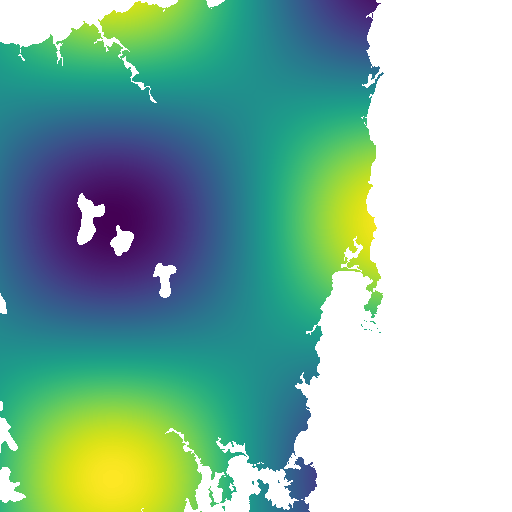
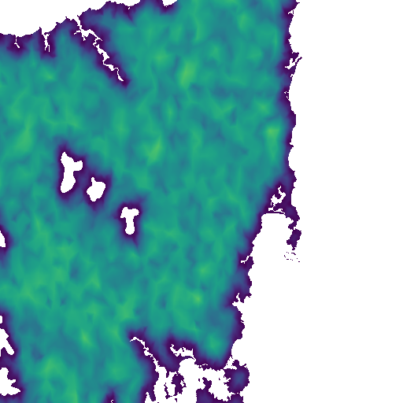

# Pilot: meshes from R as UGRID-in-Zarr, read by the Python stack

Can a mesh made in R reach the Python/Zarr/Icechunk side with nothing shared but a
file layout? This pilot writes a constrained, refined triangle mesh from R as UGRID
1.0 in a Zarr store, with no Zarr library, and opens it with xarray, uxarray, xugrid,
GDAL, xpublish-tiles and Icechunk.

It is the array-store counterpart of the [geoarrow.triangles pilot](../pilot/):
geoarrow.triangles is the wire and table form, and UGRID-in-Zarr is the form a mesh
takes beside the arrays it indexes. Background: the review of earth-mover/triangular,
the Rust Delaunay library behind xpublish-tiles. When a dataset carries UGRID
connectivity, xpublish-tiles uses it instead of triangulating.

## Files

| file | what |
|---|---|
| `ugrid_zarr.R` | `uz_write_mesh()` writes mesh spec v0.1 tables plus node/face data as UGRID-in-Zarr (v2 or v3); `uz_read_mesh()` reads it back. Base R plus jsonlite; chunks are gzip via `gzfile()`. |
| `make-mesh.R` | inlandwaters in lon/lat, triangulated by cdtr with holes, `max_area` and `min_angle = 25`, written as v2 and v3 and read back in R |
| `check.py` | opens the stores with xarray, GDAL, uxarray, xugrid and xpublish-tiles (detection, grid, two rendered tiles), then commits the store to an Icechunk repo and reopens it |
| `setup.sh` | environment: conda-forge R and Python in one env |
| `results/` | JSON output of both scripts and the two tiles |

Run:

```
Rscript survey/dev-drafts/ugrid-zarr/make-mesh.R /tmp/silicate/data/inlandwaters.rda out
python survey/dev-drafts/ugrid-zarr/check.py out 7
```

## Layout on disk

One UGRID mesh topology, 0-based keys (`start_index = 0`), and one Zarr array per
variable. Mesh spec tables map onto variables keyed by a mesh dimension:

| mesh spec v0.1 | Zarr variable | dims | type |
|---|---|---|---|
| vertices x, y | `mesh_node_x`, `mesh_node_y` | `mesh_node` | float64 |
| vertices origin | `mesh_node_origin` (CF `flag_values`/`flag_meanings`: input crossing steiner grid lattice) | `mesh_node` | int8 |
| vertices input row | `mesh_node_input_row` (-1 for added vertices) | `mesh_node` | int32 |
| triangles (CCW) | `mesh_face_nodes` (`face_node_connectivity`) | `mesh_face`, `three` | int32 |
| depth | `mesh_face_depth` | `mesh_face` | int32 |
| constraints | `mesh_edge_constrained` flag on every edge | `mesh_edge` | int8 |
| (derived) | `mesh_edge_nodes` (`edge_node_connectivity`), every triangle edge once | `mesh_edge`, `two` | int32 |
| data | `field` on nodes, `area` on faces, with `valid_min`/`valid_max` | `mesh_node` / `mesh_face` | float64 |

The topology variable also carries `meshspec = "0.1"` and `vertex_order =
"input-first"`. Connectivity is written with no `fill_value`; with one, xarray masks
it and decodes the indices as floats.

## Results

Versions: R 4.5.3, cdtr 0.1.0, GDAL 3.13.3; xarray 2026.9.0, zarr-python 3.4.1,
uxarray 2026.9.1, xugrid 0.15.3, icechunk 2.3.0, xpublish-tiles at b6b179e
(2026-10-12). 4 cores.

The mesh has 178,506 vertices (30,835 input, 147,671 Steiner), 323,676 triangles
and 502,065 edges, 36,264 of them constrained. Depth is 1 or 3 (islands in lakes)
after holes are erased. cdtr took 1.1 s. Each store is 9.8 MB.

**The R round trip is exact** in both formats: coordinates bit for bit,
triangles, depth, origin, input row, and constraints recovered as the flagged
edges.

**Every Python reader opens it unchanged.** xarray reads v2 and v3 to identical
datasets with the intended dtypes. uxarray and xugrid build grids whose face_node
connectivity equals what R wrote; xugrid puts `field` on `mesh_node` and `area` on
`mesh_face`. GDAL's multidimensional API lists the five dimensions and 11 arrays in
both formats. In Python every triangle is CCW, the written edges equal the edges
derived from faces, and V - E + F = 117.

**xpublish-tiles uses the stored mesh.** `detect_mesh` finds the topology, the grid
system is `Triangular`, and `triangular.delaunay` is called zero times, both while
building the grid and while rendering. Tile 7/116/80 (Tasmania), raster style:

| node-located `field` | face-located `area` (triangle size) |
|---|---|
|  |  |

Lakes stay holes and the coastline follows the constraints. The area tile shows the
refinement: smaller triangles along every constrained edge.

**Face-located data trips xpublish-tiles' size budget.** For `area` the request
was refused with `TileTooBigError` (about 4.7 GB estimated for about 3 MB of face values). The
estimate (`decompressed_size_bytes` in `lib.py`) does not count the face dimension
as covered by the node selection, so it multiplies the number of selected nodes by
the face chunk length. Raising `max_renderable_size` renders the tile correctly.
Their FVCOM and UGRID test datasets have 8 faces, so this is not reached there.
Worth reporting upstream; not reported.

**Icechunk works through Python.** `xr.open_zarr(v2).to_zarr(session.store,
zarr_format=3)` and one commit wrote the mesh into a local Icechunk repo in 0.4 s.
The reopened snapshot is identical to the source, keeps the UGRID attributes, and
`detect_mesh` finds the topology there too. R writes plain Zarr; the commit is a
Python step.

## What this says for the mesh spec

- UGRID-in-Zarr carries everything in v0.1 except exact coordinates. `origin`,
  `input_row`, `depth` and constraints fit as CF flag and integer variables on
  node, face and edge dimensions. Exact rationals would need string or num/den
  variables, as in the geoarrow.triangles pilot.
- Constraints sit better as a flag on a full edge set than as a partial
  `edge_node_connectivity`. UGRID readers treat that variable as the mesh's edges.
- The v0.2 constraint-to-input map is a long table with its own dimension. It was
  not written here.
- Vertex order on disk is input-first (the in-memory order). A Zarr reader does not
  re-pool, so there is no reason to renumber by first appearance as on the Arrow wire.
- No antimeridian or seam rule yet. xpublish-tiles refuses global UGRID meshes with
  explicit connectivity, so a model-level seam convention would be needed there.

## Next

- Move `uz_write_mesh()` into silicate2 beside `write_ugrid()` (netCDF) as a
  second backend, once the layout settles.
- A short section in mesh spec v0.2 naming UGRID-in-Zarr and geoarrow.triangles as
  the two encodings and how they map.
- Not done: chunking choices for large meshes (here 50,000 rows per chunk), Zarr v3
  sharding, a global mesh, and a reader that knows nothing about UGRID.
